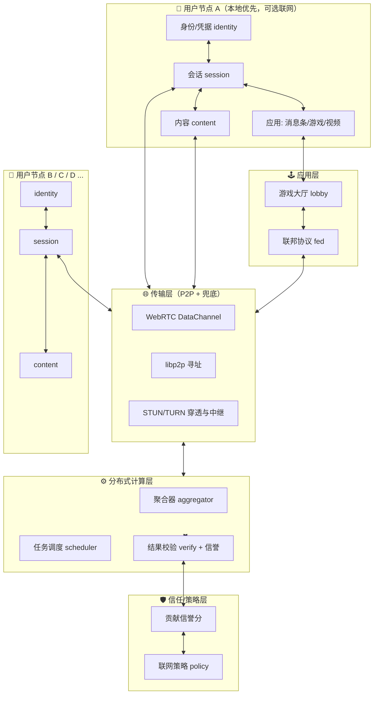

# 02 · 顶层架构拓扑

> 状态：done ✅
> 依赖：01-调研报告
> 产出：架构图 + 模块清单 + 边界/依赖/输入输出

---

## 1. 架构原则
1. **分层解耦**：下层（传输/会话）稳定，上层（应用/大厅）可插拔。
2. **本地优先**：所有数据先落本地，再按策略同步/广播。
3. **自愿联网**：节点通过策略层自主决定上线/离线/仅局域网。
4. **开放联邦**：跨平台用统一协议，拒绝私有锁定。

---

## 2. 架构拓扑图（Mermaid）

---

## 3. 模块清单（含输入/输出/依赖/风险）

### L1 · 通信层
| 模块 | 输入 | 输出 | 依赖 | 风险 |
|------|------|------|------|------|
| `transport` 传输 | 会话包 | P2P 字节流 | WebRTC/libp2p | NAT 穿透失败 |
| `signal` 信令 | 连接意图 | 已建立链路 | STUN/TURN | 中继成本 |

### L2 · 会话/身份层
| 模块 | 输入 | 输出 | 依赖 | 风险 |
|------|------|------|------|------|
| `identity` 身份 | 密钥/公钥 | 可验证身份 | 本地 Keystore | 密钥丢失 |
| `session` 会话 | 消息条 | 收敛一致的消息流 | CRDT | 多端冲突 |

### L3 · 数据层
| 模块 | 输入 | 输出 | 依赖 | 风险 |
|------|------|------|------|------|
| `content` 内容 | 媒体/消息 | 指纹+分发副本 | IPFS 风格 DHT | 存储膨胀 |
| `storage` 存储 | 写入请求 | 本地持久化 | 本地 DB | 容量上限 |

### L4 · 计算层
| 模块 | 输入 | 输出 | 依赖 | 风险 |
|------|------|------|------|------|
| `compute` 计算 | 任务 | 计算结果 | 调度器 | 节点作恶 |
| `aggregator` 聚合 | 各节点结果 | 聚合产出 | 校验器 | 结果不一致 |
| `verify` 校验 | 多副本结果 | 可信结果 | 信誉分 | 校验开销 |

### L5 · 信任/策略层
| 模块 | 输入 | 输出 | 依赖 | 风险 |
|------|------|------|------|------|
| `policy` 策略 | 网络状态/用户偏好 | 在线/离线/局域网决策 | 本地上文 | 误判 |
| `reputation` 信誉 | 历史行为 | 信誉分 | verify | 恶意刷分 |

### L6 · 应用层
| 模块 | 输入 | 输出 | 依赖 | 风险 |
|------|------|------|------|------|
| `lobby` 大厅 | 游戏/用户意图 | 匹配与连线 | signal | 延迟 |
| `fed` 联邦协议 | 跨平台事件 | 统一会话 | transport | 协议漂移 |

---

## 4. 边界定义
- **通信层**只负责"把字节送到对端"，不感知业务。
- **计算层**只负责"把任务算完并校验"，不感知聊天/游戏内容。
- **应用层**只负责"业务体验"，不直接操作传输细节。
- **信任层**横切所有层，提供授权与信誉，但**不存储业务数据**。

> 该拓扑已满足 5 项能力（C1–C5）的落位，下一环节做可行性验证。
