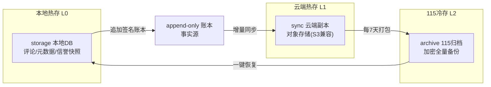
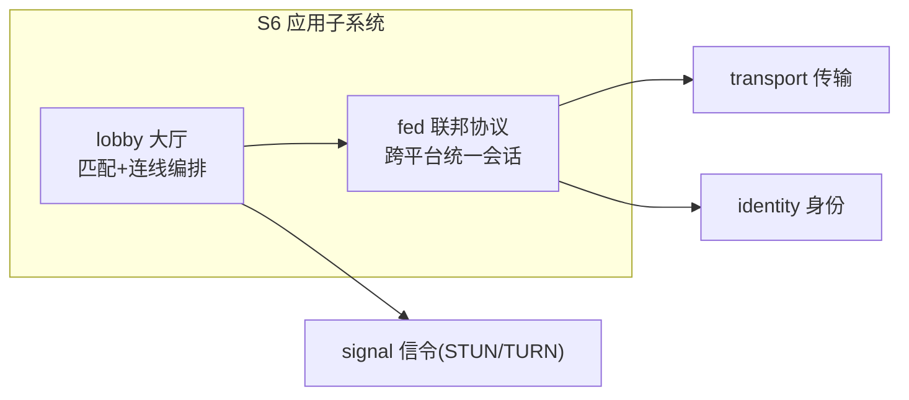

# 16 · M4b/M5/M6 与真实传输层设计（L3 细纲下钻）

> 归属：`dongdongxiaozu/fenbushijiaohu` ISSUE #19（CodeBuddy 推进计划 P1 召唤架构师）
> 角色：架构·总师（dongjiagoushi，本角色）
> 触发：CodeBuddy 汇总中 M4b/M5/M6 完成度为 0%，真实传输层仍为内存模拟、身份凭据 Keystore 未落地，请求下钻 L3 细纲
> 定位：承接 12 号文档四级粒度的 **L3 细纲阶段**，把「M4b 分层存储 / M5 游戏大厅 / M6 治理信誉 / 真实传输层 / 身份 Keystore」从"待补"落到**可编码契约**粒度，并将 06-进度对齐刷新为最新状态。
> 前置依据：09 号审查补充（云端/115/治理/信誉）+ 12 号 L2 模块纲
> 状态：in_progress（本次完成设计，待 CP1 批准后进入编码）

---

## 0. 一句话结论

> 12 号文档已给出 L0–L2 与 M1 四模块 L3 细纲。本文补齐**剩余全部 L3 细纲**：M4b（sync/archive 接口契约）、M5（lobby/fed 子系统接口）、M6（reputation/governance 模块）、真实传输层（WebRTC/libp2p 适配器契约）、身份 Keystore 持久化，并把 06 进度刷新到最新实测基线（5 包 74 测试全绿）。设计延续「本地优先 + 风险显式」总则，每个模块标注输入/输出/依赖/风险/状态机。

---

## 1. 现状基线（更新自 CodeBuddy 汇总，已核对代码基）

| 包 | 内容 | 测试 | 状态 |
|----|------|------|------|
| packages/core | M1 消息条 MVP（transport/session/identity/policy） | 11 项 | ✅ 全绿 |
| packages/net-policy | M2 联网策略（policy/relay） | 9 项 | ✅ 全绿 |
| packages/relay-mesh | M2a 中继网格+容错（health/failover/mesh/multipath） | 14 项 | ✅ 全绿 |
| packages/compute | M3 分布式计算（compute/aggregator/verify/reputation） | 28 项 | ✅ 全绿 |
| packages/content | M4 内容分发（content/storage） | 12 项 | ✅ 全绿 |
| **合计** | **5 包** | **74 项** | ✅ **全绿** |

**未落地缺口**（本文目标）：`content/sync`、`content/archive`、`lobby/fed`、`reputation 深化`、`governance`、真实 `transport` 适配器、身份 `Keystore` 持久化。

---

## 2. M4b · 分层存储 + 云端同步 + 115 冷存（L3 细纲）

> 承接 09 §4「三明治式存储 = 本地热存 + 云端热存 + 115 冷存」+ 12 L2 §4.3。本文给出可编码契约。

### 2.1 三明治分层与数据流向（Mermaid）

> 事实源 = 签名账本（append-only）；本地写 → 追加账本 → 同步云端 → 定期归档冷存。

### 2.2 模块细纲

#### M4b-A `sync.js` 云端同步
| 项 | 契约 |
|----|------|
| 职责 | 将本地签名账本增量同步到云端副本，支持多端收敛 |
| 输入 | `append(entry)` / `pullSince(cursor)` |
| 输出 | `sync(delta)` 成功/失败、`cursor` 游标 |
| 依赖 | `Storage`（本地）、云端适配器（S3 兼容）、签名账本 |
| 风险 | [MEDIUM] 云端一致性、多端冲突、云端不可用 |
| 状态机 | `idle→connecting→syncing→converged→error` |

接口签名：
```js
class CloudSync {
  async pushLocalDelta()      // 本地账本增量 → 云端
  async pullSince(cursor)     // 拉取云端增量
  getCursor()                 // 当前同步游标
  mergeConflict(a, b)         // 冲突合并（按签名账本序号/Lamport 时钟）
}
```

#### M4b-B `archive.js` 115 冷存归档
| 项 | 契约 |
|----|------|
| 职责 | 将增量账本加密打包上传 115，支持一键恢复 |
| 输入 | `archive(encryptedChunk)` / `restore(cursor)` |
| 输出 | `archiveId` / 还原的账本块 |
| 依赖 | `CloudSync`、加密层（用户公钥）、115 OAuth 授权 |
| 风险 | [HIGH] **115 API 限制**（速率/配额/授权过期）、冷存只读不热读 |
| 状态机 | `idle→encrypting→uploading→archived→restoring` |

接口签名：
```js
class Archive115 {
  async archive(ledgerDelta)      // 加密→打包→上传 115
  async restore(cursor)           // 从 115 拉取→解密→还原
  async schedule(periodDays = 7)  // 定期归档调度
}
```

> ⚠️ **R-115-限制 [HIGH]**：115 仅授权归档后端，非在线存储；需处理 OAuth 过期续期、配额上限、上传速率限制。设计上定位"防丢失"而非"热读"，规避高延迟冷存被当在线存储。

---

## 3. M5 · 游戏大厅（L3 细纲）

> 承接 12 L2 §4.6（lobby/fed）+ 07 索引「跨游戏信令 + 低延迟连线」。C4 能力。

### 3.1 子系统拓扑


### 3.2 模块细纲

#### M5-A `lobby.js` 游戏大厅
| 项 | 契约 |
|----|------|
| 职责 | 游戏/用户意图 → 匹配 → 低延迟连线编排 |
| 输入 | `join(room, profile)` / `match(players)` |
| 输出 | `Room` / `MatchResult(peers, signaling)` |
| 依赖 | `signal`、`fed`、`identity`、`transport` |
| 风险 | [MEDIUM] 匹配延迟、房间容量、作弊注入 |
| 状态机 | `idle→joining→matching→connected→playing→left` |

接口签名：
```js
class Lobby {
  async join(roomId, profile)       // 进入大厅
  async match(roomId)               // 触发匹配
  onMatch(cb)                       // 匹配结果回调
  async leave(roomId)
  getLatencyBudget(roomId)          // 延迟预算校验（低延迟约束）
}
```

#### M5-B `fed.js` 联邦协议
| 项 | 契约 |
|----|------|
| 职责 | 跨平台统一事件协议，屏蔽各游戏/平台差异 |
| 输入 | `emit(event)` / `subscribe(topic)` |
| 输出 | 统一会话事件流 |
| 依赖 | `transport`、`identity` |
| 风险 | [HIGH] 协议漂移、跨平台事件语义不一致 |
| 状态机 | `init→registering→streaming→reconnect` |

接口签名：
```js
class Fed {
  async emit(event)            // 统一事件投递
  subscribe(topic, cb)         // 订阅
  async reconnect()            // 断线重连
  mapPlatformEvent(raw)        // 平台原生事件 → 统一事件
}
```

---

## 4. M6 · 治理与信誉（L3 细纲）

> 承接 09 §5/§6（治理 + 信誉防刷）+ 12 L2 §4.5。C5「话语权回归」核心保障。

### 4.1 信誉引擎（承接 09 §6 单向棘轮）
`信誉分 = 权重(贡献量) × 行为分 × 时间衰减 × 共识锚定`

| 项 | 契约 |
|----|------|
| 模块 | `reputation/engine.js` + `reputation/audit.js` |
| 职责 | 计算信誉分，防刷分，绑定长期身份密钥 |
| 输入 | `behaviorEvent` / `contribution` / `reportVerdict` |
| 输出 | `score(account)` + 行为画像 |
| 依赖 | `verify`、`governance/verdict`、身份密钥 |
| 风险 | [HIGH] 刷分、小号绕过、新号冷启动 |
| 状态机 | `new→accumulating→stable→penalized→banned` |

接口签名：
```js
class Reputation {
  async onBehavior(account, event)     // 记录正常行为（缓慢加分）
  async onPenalty(account, reason)     // 记录破坏行为（即刻扣分留痕）
  async score(account)                 // 综合信誉分
  async snapshot()                     // 信誉快照（供归档）
  isBoostable(account)                 // 防刷：是否达到可加成门槛
}
```

#### M6-B `governance.js` 治理
| 项 | 契约 |
|----|------|
| 模块 | `governance/moderation.js` + `governance/verdict.js` + `content/report.js` |
| 职责 | 信号聚合 + 分级处置 + 透明留痕，筛正常用户、识别恶性个体 |
| 输入 | `report(evidence)` / `moderate(action)` |
| 输出 | `Verdict(level)` / 处置动作（限流/封禁/恢复） |
| 依赖 | `reputation`、`content/report` |
| 风险 | [HIGH] **误伤正常用户**、举报武器化 |
| 状态机 | `pending→reviewing→verdict→enforced` |

接口签名：
```js
class Governance {
  async report(account, evidence)      // 举报（计入信誉权重）
  async moderate(action, target)       // 分级处置
  async verdict(account)               // 裁决（封禁/限流/恢复）
  weightOf(reporter)                   // 举报者权重（防武器化）
}
```

> ⚠️ **R-治理-误伤 [HIGH]**：治理须"先限流后封禁、可申诉可复核"，低信誉新用户举报权重低，冷启动保护；封禁动作保留人工复核。

---

## 5. 真实传输层设计（WebRTC/libp2p 适配器契约）

> 承接 04 §4（transport 抽象）+ 12 L2 §4.1。当前 transport 为内存模拟，需落地真实适配器。

### 5.1 适配器抽象（`Transport` 接口）
| 项 | 契约 |
|----|------|
| 抽象 | 统一 `Transport` 接口，屏蔽底层差异 |
| 目标 | 浏览器 WebRTC / Node libp2p 双实现，可插拔切换 |
| 依赖 | 信令（ICE/SDP 交换） |
| 风险 | [HIGH] **NAT 穿透失败**、中继成本、TURN 依赖 |

接口签名（对齐 12 §5.2 transport）：
```js
// 传输抽象：connect/listen 对外不变，底层可换
class Transport {
  async connect(peer, signaling)    // 经信令建立链路
  listen(cb)                        // 监听入站
  send(channel, chunk)              // 可靠发送
  onData(cb)                        // 数据回调
  close()
}
```

### 5.2 两实现适配器

#### WebRTC 适配器（浏览器）
```js
class WebRTCTransport extends Transport {
  async _negotiate(sdp, ice)   // ICE/SDP 交换
  // 底层：RTCPeerConnection + DataChannel（DTLS 加密）
}
```
| 项 | 契约 |
|----|------|
| 适用 | 浏览器端 P2P 直连 |
| 信令 | ICE/SDP 经 signal 交换 |
| 加密 | DTLS 内建 |
| 穿透 | STUN + TURN 兜底 |

#### libp2p 适配器（Node/服务端）
```js
class Libp2pTransport extends Transport {
  async _dial(peerId)           // libp2p 拨号
  // 底层：libp2p 连接 + yamux/Noise
}
```
| 项 | 契约 |
|----|------|
| 适用 | Node/守护进程节点 |
| 加密 | Noise 握手 |
| 多路 | yamux 多路复用 |

### 5.3 NetTransport —— 真实 TCP 回环适配器（真实网络的过渡阶梯）

> 为把真实网络验证在 CI/单机即可推进，新增 **NetTransport**：用 Node 内置 `net` 模块
> 在 localhost 回环建立**真实 TCP 套接字**连接。它复用了统一的 `Transport` 接口契约
> （connect/listen/send/onData/close），上层（session 会话）无需改动即可从「内存模拟」
> 切到「真实 socket 收发」，为最终接入 WebRTC/libp2p 提供已验证的真实网络承载。

```js
class NetTransport extends Transport {
  // 每节点一个 net.Server 监听回环临时端口
  // 帧协议：[4字节大端长度][UTF-8 JSON]；握手帧 {type:'handshake'} / 'handshake-ack'
  async connect(peer, addrBook)  // 回环拨号 → 真实 TCP 连接
  send(peerId, msg)              // 写入真实套接字（返回 Promise<boolean>）
}
```

| 项 | 契约 |
|----|------|
| 底层 | Node `net` 真实回环 TCP（OS socket 层） |
| 适用 | CI / 单机真实网络收发验证、多节点 mesh 演练 |
| 协议 | 长度前缀帧 + JSON + 握手建连（仿真实建连时序） |
| 定位 | 内存模拟 → 真实 socket 网络的过渡实现，可插拔替换为 WebRTC/libp2p |

> 该适配器已在 `packages/core` 落地并 7 项测试覆盖（真实回环建连/双向收发/地址簿解析/
> 工厂创建/异常防护），6 包测试全绿。真实浏览器 WebRTC / 真实 NAT 专项验证仍依赖专项环境。

#### 5.4 NetMesh —— 多节点真实 TCP 回环 mesh 演练

> 在 NetTransport 单点直连之上，进一步落地 **NetMesh**：多节点（≥3）通过真实 TCP
> 回环套接字两两建连形成**全互联 mesh**。在 CI/单机即可演练真实网络下的多节点通信
> （广播/点对点/节点加入-掉线感知），为最终接入真实 WebRTC/libp2p 提供已验证的
> 多节点真实网络承载。

```js
class NetMesh {
  async addNode(nodeId)    // 添加节点并自动与已有节点全互联
  async removeNode(nodeId) // 移除节点（mesh 自动感知）
  async sendTo(a, b, msg)  // 点对点真实 socket 收发
  async broadcast(a, msg)  // 广播到 mesh 内全部其它节点
  getTopology()            // 当前 mesh 拓扑（含 peers）
}
```

| 项 | 契约 |
|----|------|
| 拓扑 | 全互联 mesh（每对节点间一条真实 TCP 连接） |
| 数据路径 | 发送方 → 真实 socket → 目标节点 onData 回调 |
| 加入/离开 | 节点 add/remove 后其余节点自动感知 |
| 规模 | 已测 5 节点稳定运行（含广播全达） |
| 定位 | NetTransport 单点 → NetMesh 多点 → 最终 WebRTC/libp2p 真网 |

> NetMesh 已落地（`packages/core/src/transport/mesh.js`，8 项测试覆盖），
> 6 包 152 项测试全绿。真实浏览器 WebRTC / 真 NAT 专项验证仍依赖专项环境。

> ⚠️ **R-传输-NAT [HIGH]**：浏览器 WebRTC 直连受 NAT 制约，需 STUN 打洞、失败降级 TURN 中继；relay-mesh（M2a 已落地）作为中继兜底。传输适配器为可插拔，内存模拟 `MemTransport` 保留用于测试。

---

## 6. 身份凭据持久化（Keystore）

> 承接 09 §7（Ed25519 私钥本地 Keystore）。当前 identity 未持久化。

| 项 | 契约 |
|----|------|
| 模块 | `identity/keystore.js` |
| 职责 | 本地安全持久化 Ed25519 密钥，绑定长期身份 |
| 输入 | `generate()` / `unlock(passphrase)` |
| 输出 | 公钥（可验证身份）、签名 |
| 依赖 | 本地安全存储（加密 at-rest） |
| 风险 | [MEDIUM] 密钥丢失、口令遗忘 |
| 状态机 | `generated→locked→active→revoked` |

接口签名：
```js
class Keystore {
  async generate()                // 生成并持久化 Ed25519 密钥
  async unlock(passphrase)        // 解锁
  async lock()
  sign(msg) / verify(pub, sig)    // 复用 identity 签名
}
```
> 与 M6 信誉绑定：长期身份密钥是信誉可累积的前提（非一次性匿名号，09 §6.3）。

---

## 7. 里程碑刷新（同步更新 06-进度对齐）

| 里程碑 | 完成度 | 本次状态 | 缺口 |
|--------|--------|---------|------|
| M4b 分层存储+云端+115冷存 | **0%** | ⏳ 设计就绪（本文 §2），待编码 | sync/archive 代码 |
| M5 游戏大厅 | **0%** | ⏳ 设计就绪（本文 §3），待编码 | lobby/fed 代码 |
| M6 治理与信誉 | **0%** | ⏳ 设计就绪（本文 §4），待编码 | reputation 深化 + governance 代码 |
| 真实传输适配器 | **0%** | ⏳ 设计就绪（本文 §5），待编码 | WebRTC/libp2p 适配器代码 |
| 身份 Keystore | **0%** | ⏳ 设计就绪（本文 §6），待编码 | keystore 代码 |

---

## 8. 风险清单（显式暴露，不兜底）

| 级别 | 风险 | 规避方案 |
|------|------|---------|
| HIGH | R-115-限制：115 归档受 API 限制、非热读 | 冷存定位"防丢失"，加密归档，OAuth 续期/配额处理 |
| HIGH | R-传输-NAT：WebRTC 直连受 NAT 制约 | STUN 打洞 + TURN 兜底 + relay-mesh 中继（已落地） |
| HIGH | R-治理-误伤：治理可能误伤正常用户 | 先限流后封禁、可申诉可复核、冷启动保护 |
| HIGH | R-信誉-防刷：信誉分可被刷 | 单向棘轮、绑定长期密钥、时间权重、小号共享额度 |
| MEDIUM | R-云端一致性：多端同步冲突 | 签名账本序号 + Lamport 时钟收敛 |

---

## 9. 下一步（推进度）
- [ ] 本文纳入评审（L3 细纲是否可编码）
- [ ] 张浩东批准 CP1 后，按 P0 落地 `content/sync.js` + `content/archive.js`（对应测试报告 BLK-01）
- [ ] 推进 Issue #10/#11/#12 编码深化工作
- [ ] 后续里程碑按此细纲进入编码
